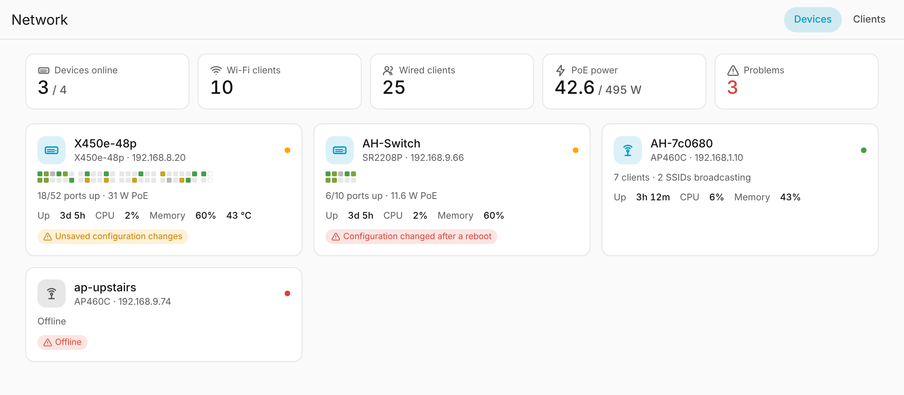
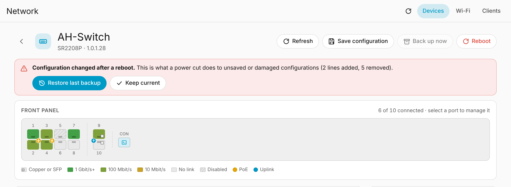

# Network panel and dashboard cards

The integration adds a **Network** page to the Home Assistant sidebar and three dashboard
cards. Nothing needs installing or configuring: they appear once the integration is loaded.
(Screenshots use demo data.)

## The Network panel



**Devices** shows every access point, router and switch with its status, a small view of the
switch ports, and any problems: offline, unsaved changes, configuration changed after a
reboot, boot problems, hardware faults. The totals at the top count online devices, Wi-Fi and
wired clients, PoE power and problems.

Select a device to open it.

### Switches


- **Front panel:** the ports laid out like the switch, odd ports on top. The colour shows the
  link speed (green 1 Gbit/s, olive 100 Mbit/s, ochre 10 Mbit/s), grey means no link and
  stripes mean the port is turned off. A yellow dot marks a port delivering PoE, a blue arrow
  an uplink. Stack members get one row each.
- **Port types:** SFP cages are drawn square, filled when a module is in (its type, e.g. `SX`,
  is in the tooltip and the port dialog) and showing an empty slot when not. Combo ports
  (copper or SFP) have a small square marker.
- **Other connectors**, next to the ports, when the device reports them: **CON** (serial
  console), **MGMT** (management port, green with link, its IP in the tooltip), **USB**
  (attached device), **PSU 1 / PSU 2** (green when powered, dashed when the slot is empty, red
  on a fault). Nothing is drawn from guesswork: see the table below for what each device
  reports.
- **Ports table:** status, what's connected (LLDP neighbour, or the device learned on the
  port), PoE power and traffic. Filter it to connected ports, PoE ports, or disabled ports and
  ports with errors.
- **Health:** uptime, CPU, memory, temperature, PoE budget, fans (with RPM) and power supplies.
- **VLANs** (ExtremeXOS), **Device** details and the last configuration backup.

Select a port, on the front panel or in the table, to manage it:


- **Port on / off.** The switch flips at once and the command is sent straight away; if
  you change your mind, flip it back and the latest choice is sent. Turning off an uplink
  asks first, because it can cut Home Assistant off from the switch.
- **PoE on / off** and **Restart PoE device** (power-cycles a camera or access point).
- **Port name** (ExtremeXOS display string, up to 15 characters, no spaces).
- **Speed**: Auto (negotiate), or a fixed 10 / 100 Mbit/s (full or half duplex), 1 Gbit/s or
  10 Gbit/s, as the port supports. Shows what the port is set to and the speed of the link.
  Changing an uplink's speed asks first. See [Port speed](switches.md#port-speed).
- The LLDP neighbour with its address, PoE draw and class, traffic, and the devices learned
  on the port, named when an access point knows their hostname.

Changes are saved on the switch a couple of seconds after the last one, in the background.

#### What each device reports

| | Port types | Console | Management port | USB | Power supplies |
| --- | --- | --- | --- | --- | --- |
| ExtremeXOS (X450e) | copper, SFP (with module type), empty cage, combo: `show ports configuration` | ✅ (every ExtremeXOS switch has one) | ✅ link and IP: `show port mgmt information`, Mgmt VLAN | – | ✅ `show power` (incl. the external backup PSU) |
| SR2208P | combo ports from the model string (*2 GE dual media ports*) | ✅ `line console` in its configuration | – | – | – |
| BR100 / APs | – | – (not reported) | – | ✅ when a USB modem is attached (`usbnet0`) | – |
| OpenWrt | SFP ports (named `sfp*`) | – | – | ✅ attached devices (`/sys/bus/usb/devices`) | – |

A connector that isn't reported isn't drawn, even if the hardware has it (for example the
BR100's and APs' console port, or an empty USB port). ExtremeXOS and SR results are from the
command reference and real SR2208P output; ExtremeXOS port types are not yet confirmed on a
device.

### Access points

Radios (band, channel, width, power, utilisation, noise, clients, SSIDs), Wi-Fi networks and
the client list with signal strength. To add networks or change passwords, use the
[Wi-Fi manager](wifi.md).

### Alerts and actions



Every device page has **Refresh** (read everything from the device now), **Save
configuration**, **Back up now** and **Reboot**. The refresh button in the top bar refreshes
every device. Alerts from
[power-loss protection](backups.md) show at the top with what to do:

- **Configuration changed after a reboot:** *Restore last backup* sends the last known-good
  configuration back and saves it; *Keep current* accepts the running configuration as the new
  known-good one.
- **Unsaved changes** (ExtremeXOS): *Save now*.
- **Reboot** on an ExtremeXOS switch with unsaved changes asks whether to save them first or
  reboot without them. It never decides for you.

### Wi-Fi

The **Wi-Fi** tab lists every network once, across all access points: turn it on or off,
turn it off (or on) for 30 minutes to 24 hours, edit the password, bands, hidden name and max
clients, add or delete networks. See [Wi-Fi networks](wifi.md#in-the-network-panel-easiest).

### Clients

The **Clients** tab lists every Wi-Fi and wired client in one place. Search it by name, MAC
address, IP address, device or port. Select a wired client to open its switch port.

### Setup

The **Setup** tab designs and changes the whole network: networks (VLANs) and their
addresses, who can reach what, Wi-Fi networks, a key per device, then review and apply it to
the router, switches and access points. Administrators only. See
[Network setup](network-setup.md).

### Phones

The panel works at phone width; the front panel wraps into rows of 12 ports.


## Dashboard cards


Add them from the card picker (search for *Aerohive*) or in YAML. The `device` option takes
the device name, as shown in the Network panel.

### Switch card

A live front panel. Select a port to get the same port dialog as in the panel.

```yaml
type: custom:aerohive-switch-card
device: X450e-48p
legend: true          # optional: colour legend under the ports
title: Garage switch  # optional
```

Each card's header also has a refresh button.

### Device card

Health, radios, last backup and problems for one device, with Save (when there are unsaved
changes), Restore (after a configuration change after reboot) and Reboot buttons.

```yaml
type: custom:aerohive-device-card
device: AH-7c0680
actions: false        # optional: hide the buttons
```

### Wi-Fi card

Switches and timers for the Wi-Fi networks, e.g. guest Wi-Fi on for 2 hours.

```yaml
type: custom:aerohive-wifi-card
networks: ["Guest Wifi"]   # optional: only these
title: Guest Wi-Fi         # optional
```

### Network card

Every device with its status, plus client and problem totals.

```yaml
type: custom:aerohive-network-card
title: Network        # optional
```

The arrow in each card's header opens that device in the Network panel.

## Notes

- **Who can use it:** the panel is visible to every user, as the integration's entities are.
  To hide it for a user, long-press the sidebar title and remove *Network*.
- **Live updates:** the panel and cards update after each poll (the scan interval in the
  integration's options), right after a change, and when you press Refresh.
- **Browser cache:** after updating the integration, reload the page if the panel looks
  outdated. The module URL includes the version, so this is rarely needed.
- **Entities:** the panel doesn't replace them. Automations, history and other dashboard
  cards keep using the [entities](entities.md).
