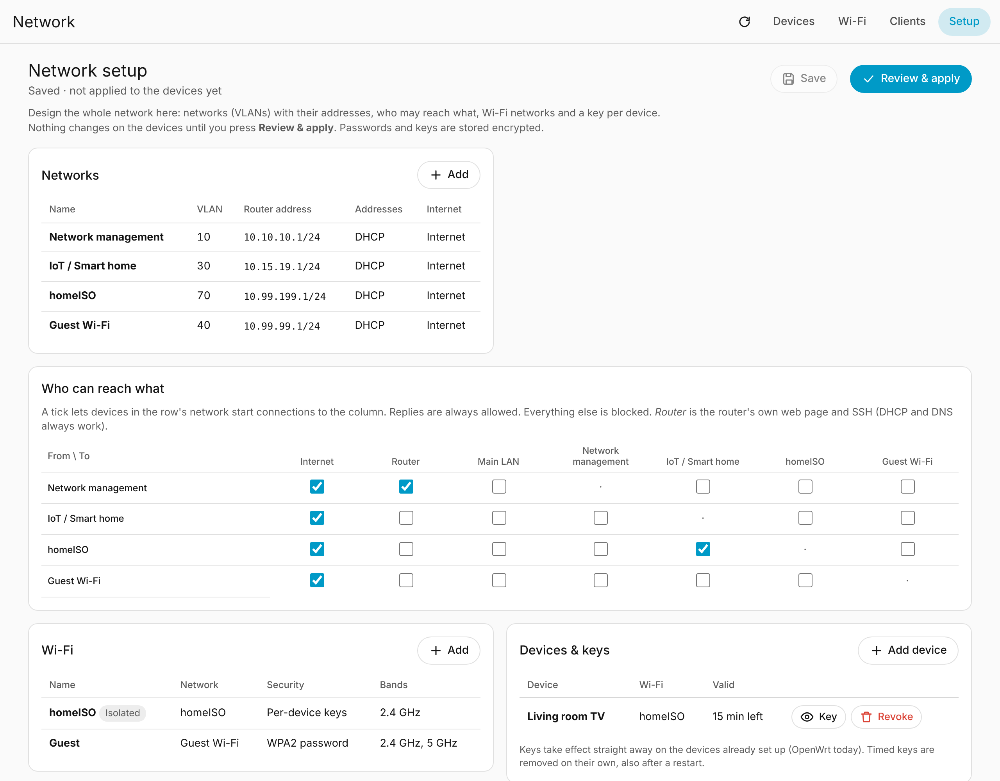
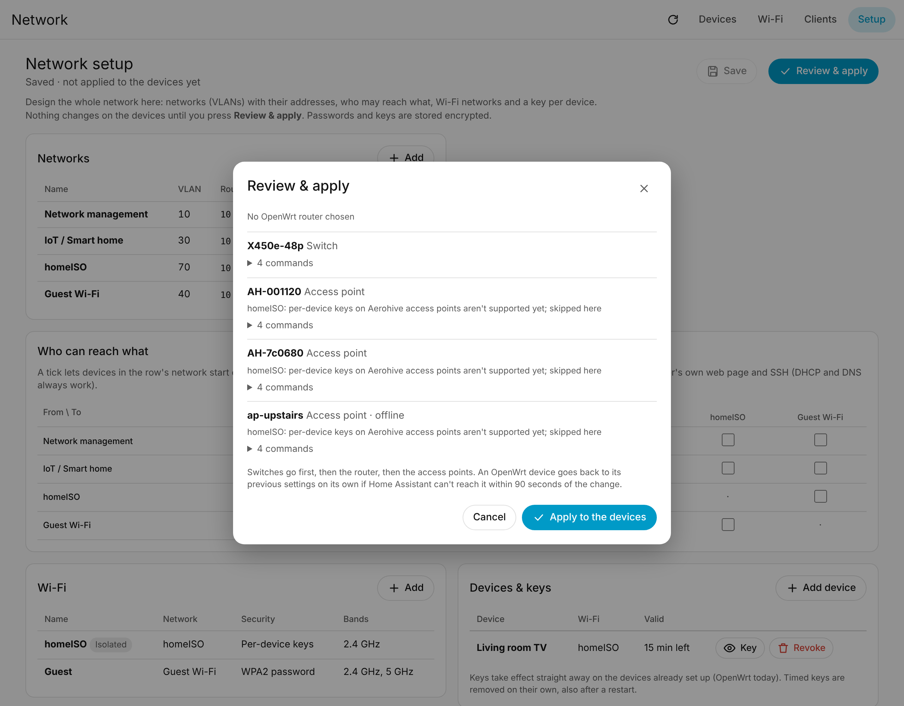

# Network setup (Setup tab)

The **Setup** tab of the Network panel is where you design and change the whole network from
Home Assistant: networks (VLANs) with their addresses, who may reach what, Wi-Fi networks,
and a key for each device. Home Assistant then works out the commands for every device,
shows them to you, and applies them when you press **Apply**. (Screenshots use demo data.)

Only administrators see and change the setup.

## How it works

1. **Design**: add networks, tick who can reach what, add Wi-Fi networks, choose which
   device is the router. Edits stay in the page until you press **Save**.
2. **Save**: the setup is stored in Home Assistant. Nothing changes on the devices yet.
   Problems (a VLAN used twice, overlapping addresses, a missing password) are listed at the
   top.
3. **Review & apply**: shows, for each device, what will be sent (passwords shown as `***`)
   and anything it can't do. **Apply to the devices** sends it: switches first (so the VLANs
   exist on the trunks), then the router, then the access points. Each device reports
   *Done* or why it failed.

Applying again is safe: every device gets the full setup again, and what an earlier apply
created but is no longer in the setup is removed.

**Start from the home layout** fills in the layout from your network plan: management
(VLAN 10), servers (20), IoT (30), guest (40), home (50), home5 (60), homeISO (70),
homeOB (80), homeHardlined (90) and Google-Auth-Home (110), with the plan's addresses
(`.1` router, `.50`–`.199` DHCP) and Wi-Fi networks. Check it, set the Wi-Fi passwords and
save; it isn't applied until you press Apply.

## Networks

Each network is a VLAN with its own addresses:

| Field | Meaning |
| --- | --- |
| Name | Shown in the panel. |
| VLAN ID | 2–4094, unique. |
| Router address | The router's address in this network with its size, e.g. `10.30.0.1/24`. |
| Hand out addresses (DHCP) | First address (e.g. 50 → `.50`), how many, lease time (`12h`, `30m`, `1d`). |
| Internet access | Devices in it may reach the internet. |
| May open the router's web page and SSH | Without it, only DHCP and DNS reach the router. |
| IPv6 | Addresses from your internet provider's prefix too (VLAN 1–255, used as the prefix ID). OpenWrt and OPNsense. |
| Ports on each ExtremeXOS switch | Ports for devices in this network (untagged), e.g. `5-8,12`. |

## Who can reach what

A grid of every network against Internet, Router, the router's existing main LAN and every
other network. A tick lets devices in the row's network **start** connections to the
column; replies are always allowed; everything else is blocked. This becomes the router's
firewall: one zone per network, forwardings for the ticks, nothing else.

Devices *inside* one network can always talk to each other at layer 2; the router can't stop
that. To keep Wi-Fi clients apart (homeISO, guest), turn on **Isolate clients** for the
Wi-Fi network.

## Wi-Fi

| Field | Meaning |
| --- | --- |
| Network name (SSID) | 1–32 characters. |
| Network (VLAN) | Which network its clients join. |
| Security | WPA2 password, WPA2/WPA3, WPA3, open, or **per-device keys**. |
| Password | Stored encrypted in Home Assistant; leave empty to keep the saved one. |
| Bands | 2.4 / 5 / 6 GHz; devices without a radio on a band skip it (with a note). |
| Broadcast, hide name, isolate clients, max clients | As they say. |

## Devices & keys (per-device keys)

A Wi-Fi network with **per-device keys** has no shared password: every device gets its own
key (PPSK). **Add device**, give it a name, choose the Wi-Fi network and optionally:

- **Put it in** another network: the key decides the VLAN, so e.g. a TV joins homeISO's Wi-Fi
  but lands in the IoT network;
- **Valid for** 15 minutes, 1 hour, 1 day or 1 week (e.g. a phone setting up Google devices);
- **MAC address**: the key only works for that device;
- your own **key** (otherwise one is made up, 12 characters, without look-alike letters).

The key is shown once it's added, and again with **Key**, with a **QR code**: scan it with
the device's camera to join without typing. Wi-Fi networks with a shared password have a
**QR** button too (handy for guests). **Revoke** removes it: that device
is disconnected and can't join again, everyone else stays connected. Timed keys are removed
on their own when they run out, also after a restart (checked every minute).

### Changing keys (rotation)

A key can be replaced without the device dropping off. **New key** on a key makes a new one
that works **alongside** the old one: put it on the device (shown with a QR code), then
press **Device updated** and the old key stops. **Keep old** throws the new key away.

- **The old key works** until you confirm, or for 1 more week, 2 weeks or a month: then the
  switch-over happens by itself.
- **All keys on a network** at once: tick *All N keys on …* in the *New key* dialog (e.g. the
  Google devices' network).
- **On a schedule:** when adding a device, *Change the key every* 3 months, 6 months or a
  year. A new key is then made by itself, with a notification ("Wi-Fi key to update") and
  the event `aerohive_local_key_rotation` (`key_id`, `name`, `wifi`, `ssid`, `cutoff`), and
  *Old key then works* sets the default switch-over. Google and Nest devices may need setting
  up again after a Wi-Fi password change, which is why the default is *until I confirm*.

Keys take effect straight away, without pressing Apply, on the devices the setup was already
applied to: only the Wi-Fi configuration is rewritten and only Wi-Fi is reloaded (clients
reconnect for a moment). If a device can't be reached, it's retried every minute and the
Setup tab says so.

## Devices

- **Router**: the OpenWrt or OPNsense router that gives every network its address, DHCP and
  firewall.
  *None* if your router is set up separately: the VLANs are still set up on switches and
  access points.
- **Router ports to the switch**: the interface(s) that carry every VLAN tagged
  (`br-lan` by default, or e.g. `eth1` on a router with separate ports). On OPNsense, the
  physical port, e.g. `igc1`; `br-lan` or empty means its LAN port.
- **Trunk ports** on each ExtremeXOS or SR switch: the ports to the router and access points;
  every VLAN is tagged on them. Port numbers like `47-48` (SR switches also take `1/0/9`).
- **Access points** that broadcast the Wi-Fi (all by default).
- **Access point only** (OpenWrt devices that aren't the router, e.g. your old router once a
  new one takes over): turns off its own router functions. Its LAN DHCP server (and IPv6
  router advertisements) and its internet (WAN) port are turned off, it uses the **main router's
  address** you enter as gateway and DNS, and it keeps its own address so Home Assistant still
  reaches it. Once the change is confirmed, its firewall and DHCPv6 services are stopped and
  disabled. Plug it into the main router or the switch with a **LAN** port. It then carries the
  VLANs and Wi-Fi like any other access point. Turning the option off again doesn't turn the
  router functions back on: do that in LuCI (or reset the device).

## What each device does

| Device | What the setup sets |
| --- | --- |
| **OpenWrt router** | For each network a bridge `br-hn<VLAN>` on `<trunk>.<VLAN>`, an interface with the router address, DHCP, a firewall zone `hn<VLAN>` with the access grid, the Wi-Fi networks, per-device keys (`wifi-station`, with `wifi-vlan` for keys that put a device in another network). |
| **OPNsense router** 🧪 | Through the API, for each network: a VLAN device `vlan0.<VLAN>` on the trunk port (or the VLAN you already have with that tag), an interface `hn_<network>` with the router address, a DHCP range on Kea or Dnsmasq (whichever is enabled), and firewall rules from the access grid marked `[HA]`. No Wi-Fi (OPNsense only routes the access points' VLANs) and no onboarding portal yet. [Details](opnsense.md#network-setup) |
| **OpenWrt access point** (not the router) | The same bridges without addresses (the router does DHCP), and the Wi-Fi networks and keys. |
| **Aerohive access point** | Per network a user profile `hn<VLAN>` (VLAN ID), per Wi-Fi network its security object pointing to it, password, hidden name, max clients and bands. |
| **ExtremeXOS switch** | Creates the VLANs (or reuses one that already has the tag), tags them on the trunk ports, puts the access ports in their VLAN. VLANs it created and that leave the setup are deleted. |
| **SR switch** (SR2208P) 🧪 | Creates and names the VLANs (`vlan database`), tags them on the trunk ports, and sets access ports (untagged, PVID). VLAN 1 (default and management) is never changed. VLANs it created and that leave the setup are deleted. **The commands are assumed** (FASTPATH style, which the switch's configuration shows) and not yet confirmed on a real SR2208P: the review says so, check it before applying. |

**Not on Aerohive access points yet:** per-device keys (that Wi-Fi network is skipped on them,
with a note), WPA3-only, and client isolation. The access points support local per-device
keys; the commands still need to be confirmed on real firmware before the integration sends
them. Until then, use a WPA2 password for networks your Aerohive access points must broadcast.

## Safety

- **OpenWrt: automatic rollback.** Before a change the four configuration files (`network`,
  `dhcp`, `firewall`, `wireless`) are copied, and a timer on the router puts them back after
  90 seconds. Home Assistant then commits, reloads, reconnects and cancels the timer. If the
  change cut Home Assistant off (a wrong trunk, for example), the router returns to the old
  settings on its own. This works like LuCI's *apply with rollback*.
- **Nothing half-done on OpenWrt.** Changes are staged with `uci` and only committed when the
  router accepted every command; one rejected command discards all of them. If the router has
  unsaved changes made in LuCI, nothing is touched until you apply or revert them.
- **Only its own sections.** Everything the setup creates on OpenWrt is named `hn_*`; your
  existing LAN, WAN, Wi-Fi and firewall rules are left alone.
- **OPNsense: only its own objects, undone on failure.** OPNsense has no rollback through its
  API, so the setup only touches what it made (`vlan0.*` devices marked `[HA]`, `hn_*`
  interfaces, `[HA]` DHCP ranges and rules) and never LAN or WAN, so Home Assistant keeps its
  way to the router. New firewall rules are added before the old ones are removed. If a step
  fails, what that apply added is removed again; afterwards the router must still answer.
- **Passwords and keys** are stored encrypted (Fernet) in
  `.storage/aerohive_local.network_plan`. The encryption key is a separate file,
  `.storage/aerohive_local.vault_key`, readable only by Home Assistant. They never appear in
  snapshots, entity states, events, the review or logs. This protects against a copied plan
  file or an over-the-shoulder look at the review. Anyone with full access to the Home
  Assistant configuration folder, or a full backup of it, has both files.
- **Activity**: saves, applies (with results) and key changes are listed with time and user.

## Onboarding portal

New devices on the onboarding Wi-Fi ask for access on a page served by the router, and you
approve them here. See [Onboarding portal](onboarding.md).

## Fixed IPs, blocked devices and port forwards

These work on the router chosen under **Devices** (OpenWrt or OPNsense) and are saved on it
**straight away**: no Review & apply needed.

- **Fixed IP** (a device's dialog in the Clients tab): the router always gives the device the
  same address, and its name (nickname or detected name, e.g. `driveway-camera`) resolves on
  your local DNS. It takes effect when the device next renews its address.
- **Block / Pause** (a device's dialog, or the `aerohive_local.block_client` action): the
  router drops everything the device sends, internet and other networks. A pause (1 hour,
  8 hours, or any number of minutes through the action) ends on its own, also after a
  restart. The Clients tab marks blocked and paused devices.
- **Port forwards** (Setup tab, *Port forwards* card): open a port (or range) on your internet
  address to a device at home, TCP, UDP or both, optionally to another port. Give that device
  a fixed IP first.

| | OpenWrt | OPNsense (API) |
| --- | --- | --- |
| Fixed IP + DNS name | `dhcp` host `hn_res_<mac>` with `dns=1` | Kea reservation (in the Kea subnet that covers the address) or Dnsmasq host; plus an Unbound host override when Unbound is the resolver |
| Block / pause | firewall rules `hn_blk_<mac>fwd` / `…in` (REJECT by source MAC) | MAC alias `HA_blocked` and one block rule (first in order) on every inside interface |
| Port forward | firewall redirect `hn_fwd_<id>` from `wan` to the device's zone | Destination NAT rule on WAN with its own pass rule |

Only what Home Assistant made is changed (names `hn_…`, descriptions starting `[HA:fixed]`,
`[HA:block]`, `[HA:forward]`). On OpenWrt nothing is done while DHCP or firewall changes made in
LuCI aren't saved yet. If the router refuses a change, nothing in Home Assistant changes
either and the error says why.

## Not part of this (yet)

See the [roadmap](roadmap.md): Dual WAN is on hold; per-device keys, WPA3 and isolation on
Aerohive access points wait for their commands to be confirmed.
