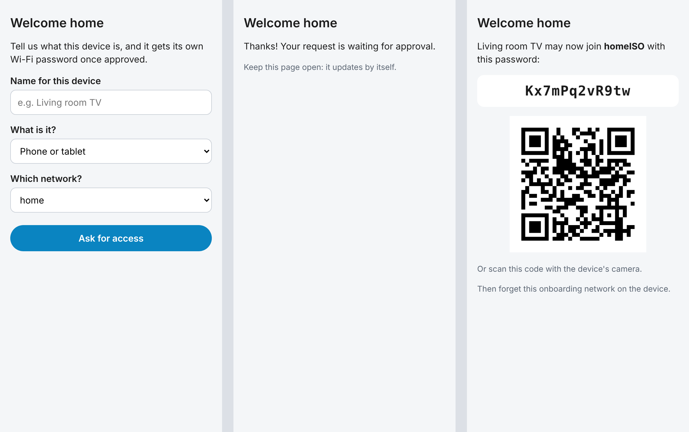
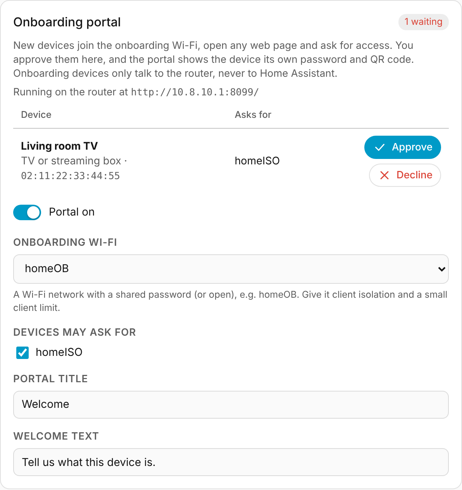
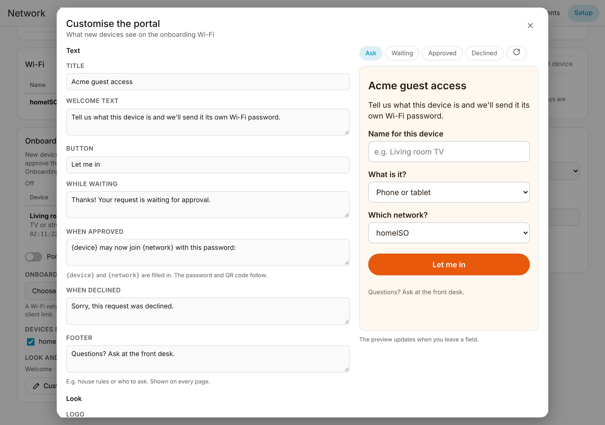

# Onboarding portal

A sign-in page for new devices on your onboarding Wi-Fi (e.g. **homeOB**). The device asks
for access; you approve it in Home Assistant; the page then shows the device its own Wi-Fi
password and a QR code. (Screenshots use demo data.)



## How it works

1. A device joins the onboarding Wi-Fi with its shared password.
2. It opens any web page (phones do this by themselves and show *Sign in to network*). The
   router sends it to the portal.
3. The portal asks for a **name**, **what it is** (from your list of device kinds) and,
   if you allow it, **which network** it wants from the ones you offer.
4. Home Assistant picks up the request within about 15 seconds. It shows it in the Setup tab,
   creates a notification and fires the event `aerohive_local_onboarding_request`.
5. **Approve**: choose the Wi-Fi network, which network (VLAN) the device lands in, how long
   the key is valid and whether it's tied to the device's MAC address. Home Assistant creates
   a per-device key, puts it on the router, and the portal shows the device the network name,
   password and QR code. **Decline**: the portal says so.



## Security

- **Onboarding devices never reach Home Assistant.** The portal runs on the router itself
  (its own web server, `uhttpd`, on port 8099 of the onboarding network's address only).
  Home Assistant reads the requests over its own SSH session to the router. With *Router*
  unticked for the onboarding network in the access grid (the default), it can only reach
  DHCP, DNS and the portal on the router.
- **Only the asking device sees its password.** When a device asks, the portal gives its
  browser a random token (a cookie). The approved page is only shown to the device with the
  same MAC address *and* that token.
- **What a device types is cleaned** on the router: names keep only letters, digits, spaces,
  `.`, `_` and `-` (40 characters); the kind and network must be one of the offered choices.
  At most 20 requests wait at once.
- **Requests expire**: unanswered requests and approved pages are removed from the router
  after an hour (and a router restart clears them, since they're kept in memory only).
- The approved page holds the key: it's written to the router's memory (`/tmp`), never to
  Home Assistant's logs.

## Setting it up

You need the OpenWrt router chosen under **Devices** in the Setup tab (see
[Network setup](network-setup.md)) with its web server (`uhttpd`, installed with LuCI).

1. In the Setup tab, make sure you have:
   - an **onboarding Wi-Fi** with a shared password (e.g. homeOB). Turn on **Isolate clients**
     and give it a small **max clients** (the plan's target is 5), and keep its network
     without internet (untick *Internet* in the grid);
   - one or more **Wi-Fi networks with per-device keys** that devices may ask for (home,
     homeISO, …).
2. In **Onboarding portal**: turn the portal on, choose the onboarding Wi-Fi and tick the
   networks devices may ask for. **Customise portal** sets the texts, look and questions
   (see below).
3. **Save**, then **Review & apply**. The review shows the portal's firewall rules; the
   apply puts the portal on the router and reports *Done*.

*Start from the home layout* prefills the portal (homeOB; home, home5, homeISO and
Google-Auth-Home on offer); it only needs turning on.

## Making it your own

The portal is generic: every text, the questions, the look and even the whole page can be
changed. In the Onboarding portal card, press **Customise portal**. The preview on the
right shows each page (*Ask*, *Waiting*, *Approved*, *Declined*) as a device will see it,
and updates when you leave a field.



- **Text:** title, welcome text, button, the waiting / approved / declined messages and a
  footer (house rules, who to ask). In the approved message, `{device}` and `{network}` are
  filled in; the password and QR code follow it.
- **Look:** a logo (PNG, JPEG, GIF, WebP or SVG, up to 70 KB) and colours for the button,
  background, text and fields. The logo is built into the page, because the onboarding
  network has no internet.
- **Questions:** your own list of device kinds (up to 12, one per line), and whether
  devices choose the network or you decide when approving.
- **Your own page:** turn on *Use my own page* and write the whole page in HTML (*Start from
  the standard page* gives you the default to edit). Placeholders:

  | Placeholder | Becomes |
  | --- | --- |
  | `{{content}}` | **Required, once.** The form, the waiting message, or the password and QR code. |
  | `{{title}}` | The title (escaped). |
  | `{{style}}` | The standard styles with your colours (for the form, password box and QR code). Leave it out to style everything yourself. |
  | `{{logo}}` | Your logo as an ``, or nothing. |
  | `{{footer}}` | The footer text, or nothing. |

  Everything has to be inside the page (no links to fonts, images or scripts on the
  internet: onboarding devices can't reach them). Your page is used as written; the parts
  the integration fills in (and everything devices type) are escaped.

Changes take effect on the router when you **Save** and **Review & apply**.

## Rules by kind of device

**Edit rules** in the Onboarding portal card: for a kind of device (from your list), choose
the Wi-Fi network, the network (VLAN) it lands in and how long the key is valid. The approve
dialog then starts with those choices.

**Approve automatically** lets every device of that kind in without asking you. Anyone with
the onboarding password can pick that kind, so use it only for isolated networks (e.g. TVs on
homeISO). Automatic approvals still fire the event (with `auto_approved: true`) and show in
the activity list.

## Limits

- **Requests per hour** (all devices together, default 10): beyond that the portal asks
  devices to try again later. Set it in the Onboarding portal card.
- At most 20 requests wait at once; unanswered ones expire after an hour.

## Approving from an automation

Each request fires `aerohive_local_onboarding_request` with `id`, `name`, `kind`,
`kind_label`, `mac`, `ip`, `wants`, `suggested_wifi` and `auto_approved`. The actions
[`aerohive_local.approve_device` and `aerohive_local.decline_device`](actions.md#onboarding-portal)
answer a request, so a phone notification can carry **Approve** and **Decline** buttons:

```yaml
automation:
  - alias: "New device wants to join"
    triggers:
      - trigger: event
        event_type: aerohive_local_onboarding_request
        event_data:
          auto_approved: false
    actions:
      - action: notify.mobile_app_my_phone
        data:
          title: "New device waiting"
          message: "{{ trigger.event.data.name }} ({{ trigger.event.data.kind_label }}) wants to join"
          data:
            actions:
              - action: "APPROVE_{{ trigger.event.data.id }}"
                title: "Approve"
              - action: "DECLINE_{{ trigger.event.data.id }}"
                title: "Decline"

  - alias: "Answer a device from the notification"
    triggers:
      - trigger: event
        event_type: mobile_app_notification_action
    conditions:
      - condition: template
        value_template: "{{ trigger.event.data.action[:8] in ['APPROVE_', 'DECLINE_'] }}"
    actions:
      - action: >-
          aerohive_local.{{ 'approve_device' if trigger.event.data.action.startswith('APPROVE_') else 'decline_device' }}
        data:
          request_id: "{{ trigger.event.data.action[8:] }}"
```

Approving this way uses the kind's rule, else what the device asked for, else the first
offered network. A simpler notification only:

```yaml
automation:
  - alias: "New device wants to join"
    triggers:
      - trigger: event
        event_type: aerohive_local_onboarding_request
    actions:
      - action: notify.mobile_app_my_phone
        data:
          title: "New device waiting"
          message: "{{ trigger.event.data.name }} ({{ trigger.event.data.kind_label }}) wants to join"
          data:
            url: /aerohive-network/setup
```

Otherwise approve and decline in the Setup tab (administrators).

## Notes and limits

- Phones and laptops often use a **private (random) MAC address** per Wi-Fi network, so the
  address on homeOB isn't the one they'll use on the new network. Leave *Only for this
  device's MAC address* off for them; use it for TVs, speakers and other fixed devices.
- The portal answers plain web pages (`http://`). A phone that opens an `https://` page first
  shows a certificate warning; its *Sign in to network* screen uses `http://` and works.
- On **Aerohive access points**, per-device keys aren't sent yet (see the
  [roadmap](roadmap.md)), so approved devices join networks broadcast by OpenWrt.
- Not yet: more than one language.
