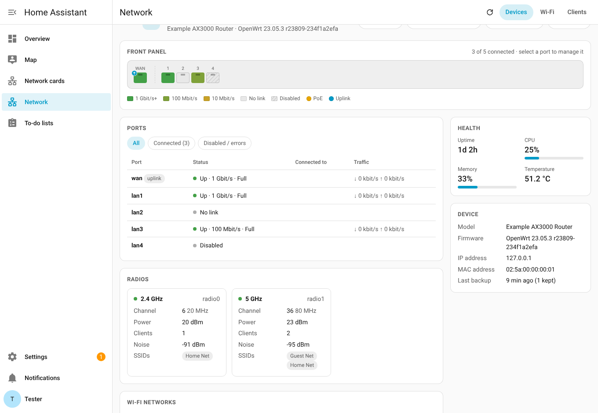

# OpenWrt routers and access points

> 🧪 **Preview.** Built from OpenWrt's documented `ubus` and UCI interfaces and tested against
> a simulated router (OpenWrt 23.05-style output), not yet a real device. Reports and output
> from real routers are very welcome.

OpenWrt devices are added like any other device: **Settings → Devices & services → Add
integration → Aerohive, Extreme Networks & OpenWrt (Local SSH)**, then the router's IP
address and its SSH login (the `root` password you set in LuCI, or an SSH key). The
integration recognises OpenWrt from the shell prompt (`root@OpenWrt:~#`).

Nothing has to be installed on the router: everything is read with `ubus` and `uci`, which
every OpenWrt image has.

## What you get

| | |
| --- | --- |
| **Device** | model, OpenWrt version, uptime, CPU, memory, temperature (where the board reports it), management IP, MAC |
| **Ports** | each Ethernet port (`wan`, `lan1`–`lan4` on most routers; `eth0`, `eth1`… on x86 and older targets): link, speed, duplex, traffic, errors. The WAN port is marked as the uplink. Shown, not switched (see below). |
| **Wi-Fi** | radios (band, actual channel and width, transmit power, noise, clients), networks, and clients with signal strength, rates, connection time, and their name and IP from the DHCP leases |
| **Wired clients** | devices on the LAN side that aren't on Wi-Fi |
| **Front panel** | SFP ports (named `sfp*`) drawn as SFP cages; attached USB devices (modems, adapters, disks) |
| **Wi-Fi control** | everything in the [Wi-Fi manager](wifi.md) and the Network panel's Wi-Fi tab: networks on/off (also for a while), bands, hidden name, password, max clients, add and delete; disconnect a client |
| **Unsaved changes** | turns on when UCI has staged changes that weren't applied, e.g. LuCI changes without **Save & Apply** |
| **Backups** | the configuration (`uci export`) is backed up like on every other device, with change-after-reboot alerts |
| **Router extras** | as the Setup tab's router: [fixed IPs with DNS names, block/pause devices, port forwards](network-setup.md#fixed-ips-blocked-devices-and-port-forwards) |
| **Reboot, Refresh now** | |

In the [Network panel](dashboard.md) an OpenWrt router shows as a router: WAN, then the LAN
ports, plus its radios and Wi-Fi networks.



## How changes are made

Wi-Fi changes are UCI commands, followed by `uci commit wireless` and `wifi reload`, as one
command line. For example, turning a network off:

```sh
uci set wireless.cfg083579.disabled=1 && uci commit wireless && wifi reload
```

- **Wi-Fi only.** The integration never changes network, firewall, DHCP or routing settings,
  so it can't cut Home Assistant off from the router. (A `wifi reload` briefly drops the Wi-Fi
  clients of the changed radios.)
- **Turning a network off** disables its UCI sections instead of deleting them, so turning it
  back on restores it on the same bands. Adding it to another band copies the existing
  section, key included, **on the router**. The key never passes through Home Assistant.
- **Saved at once.** Each change is committed, so there's nothing to save afterwards.
- **Disconnecting a client** uses hostapd's `del_client` over ubus (OpenWrt's default
  `wpad`/`hostapd` provides it).

## Keys and passwords

- Wi-Fi keys are never read into Home Assistant. When the integration reads the wireless
  configuration it filters `key`, `password`, `sae_password` and similar options **on the
  router** (`uci -X show wireless | grep -vE ...`).
- Backups mask those options (`option key '***'`) for the same reason. They're a record of
  the configuration, not a way to restore it.
- A new key you type is sent once, in the `uci set ...key=` command, and is hidden in logs.

## Limits

- **Ports are read-only.** Turning a port off on OpenWrt means changing the network
  configuration, which the integration deliberately doesn't do.
- **Restore** isn't offered for OpenWrt. Use LuCI (**System → Backup / Flash firmware**) or
  `sysupgrade -b` / `sysupgrade -r` for real backups.
- **No PoE control**, LLDP or per-port client lists. Wired clients are found from the ARP
  table, so they show up without a port.
- Older OpenWrt releases (before 21.02) may name things differently, for example `wlan0`
  instead of `phy0-ap0` or `hwmode` instead of `band`. Both are read, but they're less tested.

## Commands used

| Command | For |
| --- | --- |
| `ubus call system board`, `ubus call system info` | model, version, uptime, memory |
| `head -n 1 /proc/stat` | CPU usage (between two polls) |
| `cat /sys/class/thermal/thermal_zone0/temp` | temperature (every 15 min) |
| `ubus call network.device status` | ports: link, speed, traffic |
| `ubus call network.interface dump` | WAN port, management IP |
| `uci -X show wireless` (secrets filtered) | radios and Wi-Fi networks, including disabled ones |
| `ubus call network.wireless status` | which networks are running, and their interface names |
| `ubus call iwinfo info / assoclist '{"device":"phy0-ap0"}'` | channel, power, noise; clients |
| `cat /tmp/dhcp.leases`, `cat /proc/net/arp` | client names and IPs; wired clients |
| `uci changes` | unsaved changes |
| `uci export` (secrets masked) | backups (every 15 min and after changes) |
| `uci set/add/delete wireless...`, `uci commit wireless`, `wifi reload` | Wi-Fi changes |
| `ubus call hostapd.<interface> del_client` | disconnect a client |
| `reboot` | reboot |

## SSH login

- **Password:** the `root` password set in LuCI (**System → Administration → Router
  Password**). OpenWrt's SSH server (dropbear) allows password login on the LAN by default.
- **SSH key:** add Home Assistant's public key under **System → Administration → SSH-Keys**,
  and give the private key's path when adding the device.
- A non-root user needs permission to run `ubus`, `uci` and `wifi`; with `root` it just works.
