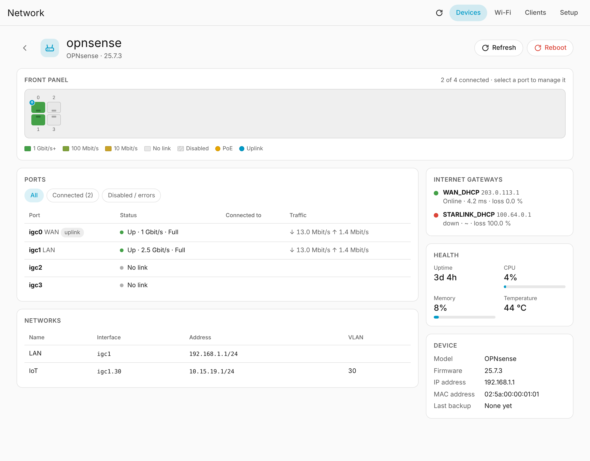

# OPNsense routers (preview)

Monitoring, ports, backups, the network setup (VLANs, interfaces, DHCP, firewall, IPv6), fixed
IPs, blocking, port forwards and the onboarding portal all work with OPNsense.

OPNsense is read through its **REST API** with an API key, not over SSH. Nothing is installed
on the router. (Screenshot uses demo data.)

## Adding it

1. In OPNsense: **System → Access → Users**, edit a user (or create one for Home Assistant),
   and under **API keys** press **+**. Your browser downloads a file with the `key` and
   `secret`.
   - To monitor only, the user needs read access to the dashboard, diagnostics, interfaces
     and gateways (e.g. the *Dashboard*, *Diagnostics: …*, *Status: Interfaces* and
     *Status: Gateways* privileges). Reboot from Home Assistant needs a user that may
     reboot (e.g. *System: Firmware*, or full access).
2. In Home Assistant: **Settings → Devices & services → Add integration → Aerohive /
   Extreme Networks (Local SSH) → OPNsense router (API key)**.
3. Enter the router's address, HTTPS port (443 by default), the key and the secret. Leave
   **Check the HTTPS certificate** off for OPNsense's own self-signed certificate; turn it on
   if the router has a trusted certificate.

If the key is later deleted or changed, Home Assistant asks for a new one (a repair).

## What's read

| | API endpoint |
| --- | --- |
| Hostname, version | `diagnostics/system/system_information` |
| CPU, uptime, load | `diagnostics/activity/get_activity` (top's header) |
| Memory | `diagnostics/system/system_resources` |
| Temperature (hottest CPU sensor) | `diagnostics/system/system_temperature` |
| Physical ports: link, speed, duplex, MAC, assignment (WAN/LAN/…), traffic, errors | `interfaces/overview/interfaces_info/1` |
| Networks (assigned interfaces with an address, VLAN tag) | same |
| Internet gateways: online, delay, loss | `routes/gateway/status` |
| Devices behind the router: IP and hostname | `diagnostics/interface/get_arp` and DHCP leases from Kea (`kea/leases4/search`), Dnsmasq (`dnsmasq/leases/search`) or ISC (`dhcpv4/leases/search_lease`), whichever is in use |

Endpoints the router doesn't have (an older version, a feature not in use) are skipped: that
value is just unknown.

In the Network panel the router shows its ports (WAN marked as uplink), **Internet
gateways** with their status (a gateway that's down is listed as a problem), **Networks**,
health and device details. Devices behind it appear in the **Clients** tab with the names
and addresses from ARP and DHCP (see [client details](dashboard.md#clients)).

**Reboot** works from the device page and the `aerohive_local.reboot` action (it calls
`core/system/reboot`).

## Network setup

Choose the OPNsense router as **Router** in the Setup tab's Devices card (see
[network setup](network-setup.md)). **Router ports to the switch** is the physical port that
carries the VLANs tagged, e.g. `igc1`; leave `br-lan` or empty to use the LAN port.

On **Apply**, for each network, through the API:

| Step | API | What |
| --- | --- | --- |
| VLAN | `interfaces/vlan_settings` | `vlan0.<VLAN>` on the trunk port, description `[HA] <network>`. A VLAN you already have with that tag on that port is used as it is (and never deleted). |
| Interface | `interfaces/assignment` | `hn_<network>` on that VLAN, enabled, static IPv4 with the router address, e.g. `10.15.19.1/24`. |
| DHCP | `kea/dhcpv4` or `dnsmasq/settings` | Whichever server is enabled: a Kea subnet (pool, lease time, router and DNS options from the interface) and Kea listening on the interface, or a Dnsmasq range. Description `[HA] <network>`. If neither is enabled, the result says so. |
| Firewall | `firewall/filter` (+ `apply`) | Rules on each `hn_` interface, in order: DHCP; DNS to the router; the router itself (pass if the network may open the router's pages, else block); the networks it may reach (and the main LAN); block other private addresses (10/8, 172.16/12, 192.168/16); internet if allowed. Descriptions start with `[HA]`. |

Each kind of change is applied with its own *reconfigure* / *apply* call. A network removed
from the setup loses its interface, `[HA]` VLAN, DHCP range and rules.

**The API key's user** needs, besides the read access above, the privileges *Interfaces:
VLAN*, interface assignments (*Interfaces: Assignments*), *Firewall: Rules [new]*, and
*Services: DHCP: Kea(v4)* or *Services: Dnsmasq DNS/DHCP: Settings* (or simply full access).
Without them the apply stops and says the key may not make the change.

**Safety.** OPNsense has no rollback through its API, so the setup:

- only changes what it made (`[HA]` VLANs and rules, `hn_` interfaces, `[HA]` DHCP ranges),
  never LAN, WAN or your own rules: Home Assistant keeps reaching the router on its LAN
  address;
- refuses to take over a VLAN interface you assigned yourself;
- adds new firewall rules before removing the old ones;
- removes what that apply added if a step fails (best effort; the result lists anything it
  couldn't remove);
- checks the router still answers afterwards.

Built from the controllers and models in OPNsense's source and tested against a simulated
router; **not yet confirmed on a real OPNsense**. Try it with one test network first.

## Fixed IPs, blocked devices and port forwards

See [network setup](network-setup.md#fixed-ips-blocked-devices-and-port-forwards). On
OPNsense they use Kea reservations or Dnsmasq hosts, Unbound host overrides (domain from the
router's own), a MAC alias `HA_blocked` with one block rule, and destination NAT rules on WAN.
Blocking by MAC works for devices in the same network as one of the router's interfaces
(the router learns the address from ARP). The API key needs *Firewall: Aliases* and
*Firewall: NAT: Destination NAT* (or full access) too, and *Services: Unbound DNS* for DNS names.

## Ports

Ports assigned to an interface (WAN, LAN, OPT…) can be turned **on and off** and set to a
**fixed speed** (port dialog, `set_port` and `set_port_speed`), through the interface's
*enable* and *media* settings (`interfaces/assignment`, then *reconfigure*). The speeds offered
are the media types the router reports for the interface. Not possible: turning off the port
Home Assistant reaches the router through; turning off WAN needs `force`. Unassigned ports stay
read-only. The API key needs *Interfaces: Assignments*.

## Configuration backups

`config.xml` is read through `core/backup/download/this` (every 15 minutes and after changes
from Home Assistant) and backed up like every other device's configuration, with
change-after-reboot alerts ([backups](backups.md)). **Passwords, password hashes, private keys,
pre-shared keys, API keys and other secrets are replaced by `***` before anything is saved**,
so a changed secret still shows as a change but never lands in Home Assistant. These backups
are for comparing and keeping track; to go back to an older configuration use OPNsense's own
history (System → Configuration → History), which has the secrets. The API key needs
the privilege for the configuration backups page (*System: Configuration: Backups*, or full
access); without it, no backups are taken.

## Onboarding portal

Served by Home Assistant and forwarded by the router: see
[Onboarding portal on OPNsense](onboarding.md#on-an-opnsense-router).

## IPv6

A network with **IPv6** turned on (network dialog in the Setup tab) gets addresses from your
internet provider's delegated prefix: the interface tracks WAN (`type6 track6`) with the VLAN
as prefix ID (so VLAN 1–255). The firewall rules then cover IPv6 too: DHCPv6, DNS, the router,
the networks it may reach, other networks' prefixes and local (ULA) addresses blocked,
internet if allowed. On OpenWrt the same option sets `ip6assign 64` with the VLAN as hint, and
router advertisements and DHCPv6 on that network.

## Not (yet) on OPNsense

- **PoE** (OPNsense boxes have none) and **restoring** a backup from Home Assistant (use
  OPNsense's own history).
- `run_show_command` and other SSH-only actions.

Built from the API controllers in OPNsense's source (opnsense/core, November 2026) and tested
against responses of that shape; not yet confirmed on a real router.
