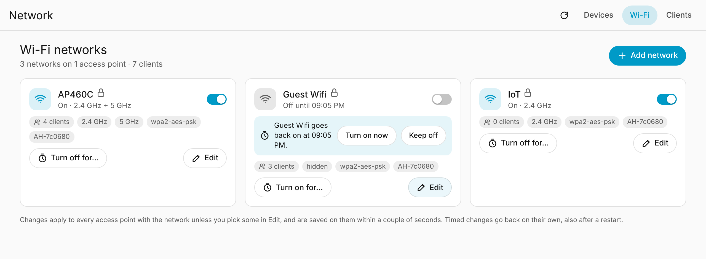

# Managing Wi-Fi networks (SSIDs)

## In the Network panel (easiest)

Open **Network** in the sidebar → **Wi-Fi**. Every network is listed once, however many
access points have it, with its bands, clients and whether it's hidden or open.



- **On / off:** the switch on each network turns it on or off on every access point that
  has it.
- **Temporarily:** *Turn off for…* / *Turn on for…* picks 30 minutes to 24 hours. Afterwards
  the network goes back to exactly how it was (the same bands on the same access points),
  even if Home Assistant restarts in between. While a timer runs, the network shows when it
  goes back, with *Turn on now* / *Keep off*.
- **Edit:** new password (leave empty to keep the current one), bands (2.4 GHz / 5 GHz; none
  turns it off), hide the name, max clients, and which access points to change. Delete is
  here too.
- **Add network:** name, password (empty = open network), bands, hidden, access points.

Only administrators can change networks; other users see them read-only. Passwords go
straight to the access points over Home Assistant's WebSocket connection, and are never
stored, logged or put on the event bus.

On an access point's page in the panel, select a network to change it on that access
point only.

For a dashboard, the **Aerohive Wi-Fi** card has the same switches and timers, for example
for a guest network:

```yaml
type: custom:aerohive-wifi-card
networks: ["Guest Wifi"]   # optional: only these networks
title: Guest Wi-Fi         # optional
```

In automations, use the [`set_ssid` action](actions.md#aerohive_localset_ssid):

```yaml
action: aerohive_local.set_ssid
data:
  ssid: Guest Wifi
  enabled: true
  duration: "02:00:00"     # optional: back to how it was after 2 hours
```

## The Wi-Fi manager (integration options)

**Settings → Devices & services → Aerohive / Extreme Networks → (your AP) → Configure →
Manage Wi-Fi networks.** Or open it on the **Aerohive Network** entry to manage all APs at once.

1. **List:** every network with its status, e.g.
   `AP460C — on wifi0 (2.4 GHz), wifi1 (5 GHz) · 3 clients · hidden`.
2. **Pick a network** to open one form with:
   - **New password**: leave empty to keep the current one
   - **Broadcast on**: tick the radios. Untick all to stop broadcasting without deleting.
     On the overview, this is **Broadcast on all access points**.
   - **Hide network name**
   - **Max clients**
   - **Delete this network** (asks for confirmation)

   Everything in the form is applied together with **one** `save config`. If the device
   rejects something, its message is shown in the form.
3. **➕ Add a new Wi-Fi network:** name, password (empty = open network), radios (or, on
   the overview, which access points), hidden.
4. **✔ Done** closes the dialog.

The current password can't be shown, because the device stores keys encrypted. Typed
passwords are never kept in Home Assistant (no entity state, recorder or log).

## Entities (dashboards and automations)

| What | On one AP | On all APs (Aerohive Network device) |
| --- | --- | --- |
| Change the Wi-Fi password | text `<SSID> Wi-Fi key` | text `<SSID> Wi-Fi key (all APs)` |
| Turn an SSID on/off | switches `<SSID> on wifiN (band)` / `<SSID> on all radios` | switch `<SSID> on all APs` |
| Hide / unhide | switch `<SSID> hidden` | – |
| Max clients | number `<SSID> max clients` | – |
| Status | `SSIDs broadcasting`, `<SSID> broadcasting`, `<SSID> clients`, `<SSID> security` | `SSIDs` (table attribute), `<SSID> clients (all APs)` |

The actions `create_ssid`, `delete_ssid` and `set_ssid_password` do the same for automations.

**Deleted SSIDs disappear:** when an SSID is gone from the AP, its entities (switches, Wi-Fi
key, max clients, sensors, overview controls) are removed from Home Assistant, rather than
left behind as "unavailable". After a delete made from Home Assistant this happens on the
next poll. If the SSID was removed elsewhere (CLI, HiveManager), it happens once it has been
missing for two polls in a row, so one odd reply can't wipe your entities. Leftovers from
SSIDs deleted while Home Assistant was off are cleaned up at startup. Re-creating an SSID
brings its entities back. The same applies to the trackers and sensors of clients you remove
from "Clients to track". The overview keeps an SSID's entities while an AP that has it is
offline.

**Upgrading from an older version:** the Wi-Fi key boxes and port switches used to be created
disabled. Version 0.5 enables them once, automatically. Anything you disabled yourself stays
disabled.
